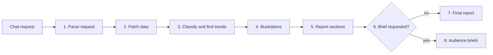

# Retail Trend Discovery Agent

[](https://github.com/Ajay-D92/e-commerce-trend-discovery-agent/actions/workflows/tests.yml)

An n8n agent that turns a one-line chat request into a trend report, or into a brief written for one team.

```
You type:   area rug brief for marketing
You get:    a marketing brief (HTML) with trend segments, evidence levels,
            creative ideas to test, and AI-generated illustrations
```

Built by Ajay Dhankar. The data is a stored snapshot of products, social posts and articles, not a live feed.

## Why it exists

A trend report written for everyone gets read by few. A supplier needs specifications and counts. Marketing needs ideas to test. Leadership needs a decision and an honest view of the evidence. The agent builds one set of facts and writes a different page for each audience.

## What you can ask it

| Chat request | What comes back |
|---|---|
| `area rug` | Full trend report |
| `area rug brief for marketing` | Marketing and creative brief only |
| `supplier brief for shag rug` | Supplier and product-development brief only |
| `leadership brief for area rug` | Leadership decision brief only |
| `area rug briefs` | All three briefs |

Supported categories: area rug, outdoor rug, hallway runner, shag rug. An optional `focus: washable` narrows the search.

Every result is a standalone HTML file with its own `validation` block (`isValid`, warnings, image count).

## Sample output

- [`samples/marketing_brief_area_rug.html`](samples/marketing_brief_area_rug.html): marketing brief with embedded illustrations
- [`samples/trend_report_area_rug.html`](samples/trend_report_area_rug.html): full trend report

Download and open them in a browser. GitHub shows HTML files as text.

## The eight stages

`workflow.json` is the complete workflow (78 nodes). `stages/` holds each stage as its own workflow, with a local test suite where one exists.

| Stage | What it does | File in `stages/` | Checks |
|---|---|---|---|
| 1. Input and routing | Reads the category, an optional focus and the brief type; rejects unsupported requests | `stage1_input_and_routing` | 61 |
| 2A. Amazon products | Fetches products and reshapes them | `stage2a_amazon_products` | 18 |
| 2B. Social, blog and market data | Fetches Instagram, Pinterest, blog and market data; cleans captions and hashtags; checks post dates | `stage2b_social_blog_market_data` | 59 |
| 3. Classify and find trends | Judges which products belong to the category, standardises attributes, builds trend segments with counted evidence | `stage3_classify_and_trends` | 63 |
| 4. Illustrations | Writes an image prompt per segment, generates the image, encodes it | `stage4_illustrations` | none (tested through the full workflow) |
| 5. Report sections | Extracts article knowledge, writes seven report sections with one model call each, checks every section | `stage5_report_sections` | 69 |
| 6. Routing | The `Brief requested?` check sends brief requests to Stage 8 and all others to Stage 7 | in `workflow.json` | none (tested through the full workflow) |
| 7. Final report | Assembles and validates the HTML report | `stage7_final_report` | 21 |
| 8. Audience briefs | Builds the supplier, marketing and leadership briefs | `stage8_audience_briefs` | 27 |



The workflow has 13 AI agents, 25 JavaScript code nodes, 5 data fetches, one image-generation call and wait nodes that keep free-tier models inside their rate limits. The stage files in `stages/` are earlier standalone versions. The Stage 8 file does not include the chat routing or the later wording fixes, which are in `workflow.json`.

## The code decides, the model writes

- **Facts come from code.** Counts, prices, shares and "how many of 13 posts mention this" are calculated, never written by a model.
- **The model returns structured JSON only.** Raw model text never goes straight into a page.
- **Every model string is checked.** Anything containing a number that is not in the data, or a claim like "proven", "popular" or "customers prefer", is dropped.
- **Article claims must quote the article.** A claim is kept only if its supporting quote appears in the stored article text.
- **Evidence is counted.** Each trend segment is rated `stronger`, `moderate`, `weak` or `unverified` from the share of posts that mention its attributes. Confidence stops at medium.
- **Failures are visible.** If a model call fails, the result says so (`ai_unavailable`, `ai_output_invalid`) and validation fails. The page never fills the gap with made-up content.
- **Every page states its limits:** sample size, data age and missing sales data.

## Tests

Each stage was built and tested on its own with mock data before it joined the next. The tests need no AI, no network and no n8n.

**318 checks across 7 suites, all passing,** plus a 12-case guardrail eval. GitHub runs them on every push. Run any suite from the `stages/` folder:

```bash
cd stages && node stage8_audience_briefs.test.js
```

The Stage 8 suite feeds the model-output checker good, malformed, hostile and missing answers to confirm none reaches a page unfiltered. The guardrail eval in `eval/` replays 12 recorded model replies through the same checker, including one that slipped through in a real run. `eval/` also holds a scoring rubric for the quality of the briefs, which has not been run yet.

## Problems I hit and how I solved them

- **AI failures that still passed validation.** When a model call hit a token limit, the marketing page could still pass. The validator now reads the AI status and fails the marketing item when no ideas were generated.
- **A model router that answered with the wrong kind of model.** One run was answered by a safety classifier ("User Safety: safe"), which gave unusable output. Naming a specific instruct model fixed it.
- **Silent failures after renaming nodes.** Code nodes look up other nodes by exact name. Pasting into an existing workflow added a `1` to every name, so lookups returned empty data with no error. Importing into an empty workflow fixed it.
- **"Existing execution data is too large."** n8n refuses to run a single node when base64 images are repeated across nodes. I tested later stages from small pinned data and kept images out of the pins.
- **Wrong comparisons from the model.** It filed "low-pile" (7 of 7 products and 1 of 13 posts) under "only among Amazon values". The code now writes the comparison sentences and the model copies them.
- **Empty answers from reasoning models on small token limits.** A non-reasoning model fixed it.
- **Cut-off and garbled text.** Claims clipped at 40 characters and raw article snippets with broken spacing were fixed by raising the limit and showing only the figure and its source.
- **A gap in the claims filter.** "Shoppers may prefer" slipped past a pattern that only caught "shoppers prefer". I found it in a real run and tightened the prompt and the pattern.

## Run it yourself

1. In n8n, create a new **empty** workflow, then use **Import from file** and choose `workflow.json`.
2. Create credentials for Groq, OpenRouter and the image-generation API (bearer token). The repository stores no keys, so n8n asks you to pick credentials on each model node.
3. Replace two placeholders: `YOUR-DATA-API-HOST` in the five fetch nodes (your product and trend data source) and `YOUR_CLOUDFLARE_ACCOUNT_ID` in the image node.
4. On the model nodes, choose a specific model. Avoid `openrouter/free`, which can route to a model that breaks the JSON output.
5. Open the chat and send a request from the table above. A full run makes about 14 model calls.

## Limits

- The data is a small, dated snapshot: 13 social posts and a handful of products. Evidence levels are low to moderate.
- No sales, traffic or search data was available, so nothing here measures demand. Every brief says so.
- Stages 4 and 6 have no standalone tests, and the stage tests predate the chat routing and the last wording fixes.
- Next steps: connect sales and search-volume data, add a live social source, label market figures more clearly, and add an automatic check that every number on a page appears in the data.

## Repository layout

```
workflow.json        The complete workflow (import into n8n)
stages/              Each stage as its own workflow, plus its test suite
eval/                Guardrail eval and a quality rubric
samples/             Example outputs
.github/workflows/   Runs the tests on every push
```

Licensed under MIT (see `LICENSE`).
